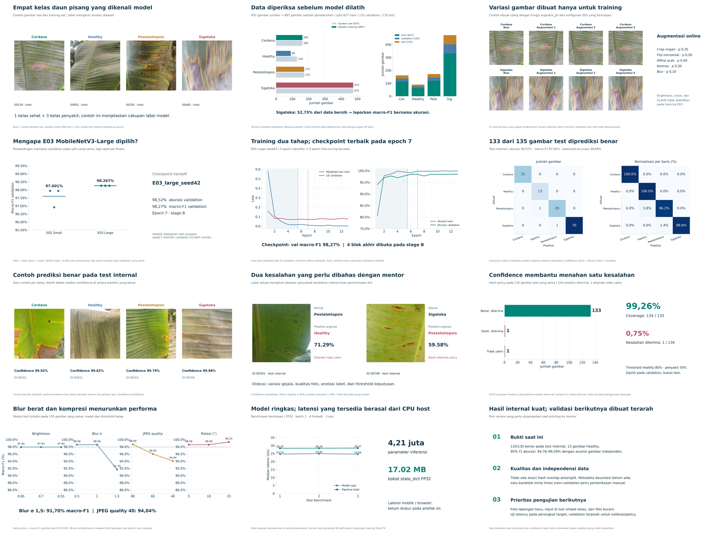

# PisangLENS

**PisangLENS** adalah Progressive Web App untuk membantu identifikasi awal empat kondisi daun pisang menggunakan MobileNetV3. Inferensi utama berjalan di peramban dengan TensorFlow.js dan model lokal; aplikasi menyediakan alur kamera, riwayat, kamus kondisi, persiapan luring, serta konsultasi dengan botani.



> Hasil aplikasi adalah identifikasi awal pada empat kelas yang didukung. Hasil bukan diagnosis agronomis dan tidak menjamin kondisi tanaman. Foto di luar cakupan model, kualitas rendah, atau kondisi lapangan berbeda dapat menghasilkan prediksi keliru.

## Fitur

- PWA responsif dengan manifest dan service worker.
- Pemotretan atau unggah foto daun, pemeriksaan kecerahan, dan inferensi lokal melalui TensorFlow.js.
- Dukungan empat label: **Healthy**, **Cordana Leaf Spot**, **Pestalotiopsis Leaf Blight**, dan **Sigatoka**.
- Kamus kondisi, riwayat lokal per akun melalui IndexedDB, dan sinkronisasi ke backend saat daring.
- Autentikasi Petani, Botani, dan Admin dengan backend PHP/MySQL; verifikasi akun botani dan konsultasi.
- Pesan konsultasi dienkripsi AES-GCM di sisi klien. Server mengelola kunci induk, jadi desain ini **bukan end-to-end encryption (E2EE)**.
- Paket inference Python opsional untuk menjalankan model yang sama dari CLI atau kode Python.

Service worker menyiapkan aset publik dan model untuk penggunaan luring. Endpoint API privat tetap diakses melalui jaringan. HTTPS diperlukan untuk kamera dan service worker pada deployment publik.

## Model dan hasil evaluasi

Model yang dipakai aplikasi adalah **E03 MobileNetV3-Large, seed 42**, dengan 4.207.156 parameter. Model menerima input RGB 224×224, memakai resize bilinear antialias tanpa crop, normalisasi ImageNet satu kali, dan temperature scaling. Versi TensorFlow.js lokal dipatok ke 4.22.0; bobot aplikasi disimpan sebagai shard terkompresi lossless dan diverifikasi dengan SHA-256 sebelum digunakan.

| Evaluasi internal | Hasil tersimpan |
| --- | ---: |
| Test accuracy | 98,52% (133/135) |
| Test macro-F1 | 97,94% |
| Validation macro-F1, rerata 3 seed E03 | 98,27% |
| Policy confidence | 134/135 diterima; 1 prediksi diterima salah dan 1 uncertain |

Angka ini berasal dari evaluasi internal pada dataset yang digunakan dalam eksperimen, bukan dari uji lapangan independen. Validation yang sama digunakan untuk seleksi model, kalibrasi, dan policy, sehingga estimasi pengembangan dapat optimistis. Model belum memiliki detektor untuk gambar bukan daun pisang atau kondisi di luar empat label. Blur berat menurunkan performa. Ambang confidence adalah aturan tindak lanjut, bukan jaminan akurasi untuk satu foto.

Rincian, grafik, interval, dan penjelasan batas bukti tersedia di [laporan analisis](research/analysis/laporan_analisis.html) dan [model card](model-python/README.txt). Dataset rujukan: [BananaLSD](https://data.mendeley.com/datasets/9tb7k297ff/1). Periksa ketentuan dataset dan hak penggunaan gambar sebelum mempublikasikan aset turunan.

## Isi repository

```text
.
├── public/                 # Web root PWA, API PHP, TensorFlow.js dan model browser
├── config/                 # Contoh konfigurasi backend tanpa rahasia
├── lib/                    # Helper PHP di luar web root
├── sql/                    # Skema, seed admin, dan migrasi
├── scripts/                # Utilitas backend dan siklus data/model
├── tests/                  # Uji JavaScript, PHP, integrasi, dan preprocessing
├── model-python/           # Paket inference Python dan bobot PyTorch final
├── research/
│   ├── PisangLENS.ipynb    # Notebook eksperimen MobileNetV3
│   └── analysis/           # Laporan, tabel hasil, plot dan provenance analisis
└── docs/pitching/E03_Large/ # Katalog pitch, 12 plot utama, plot pendukung, narasi
```

Artefak training besar, dataset mentah lengkap, cache eksperimen, dan checkpoint per-run tidak dimasukkan. Hasil analisis dan paket inference yang dipilih tetap disertakan. Skrip pembuatan ulang laporan dan paket pitching memerlukan artefak training asli yang tidak berada di repository ini.

## Menjalankan PWA secara lokal

### Prasyarat

- PHP 8.3 atau kompatibel, dengan PDO MySQL dan Fileinfo aktif.
- MySQL.
- Node.js hanya diperlukan bila menjalankan suite tes JavaScript.

### Persiapan backend

1. Buat database MySQL bernama `pisanglens`, lalu impor skema: `mysql -u root -p pisanglens < sql/schema.sql`.
2. Salin `config/config.example.php` menjadi `config/config.php`, kemudian isi DSN, nama pengguna, dan kata sandi database untuk lingkungan lokal. File `config.php` tidak dilacak Git.
3. Buat direktori penyimpanan foto dan kunci chat di luar web root:

   ```sh
   mkdir -p storage/uploads
   php -r 'file_put_contents("storage/chat-master.key", random_bytes(32)); chmod("storage/chat-master.key", 0600);'
   ```

4. Buat akun Admin awal dengan mengatur variabel sesi MySQL `@admin_name`, `@admin_email`, dan `@admin_password_hash` (hash dari `password_hash()`), lalu jalankan `sql/seed.sql` pada sesi yang sama. Jangan masukkan kata sandi atau kunci nyata ke repository.
5. Sajikan direktori `public/` sebagai document root. Untuk pengembangan lokal:

   ```sh
   php -S localhost:8000 -t public
   ```

6. Buka `http://localhost:8000`. `localhost` merupakan secure context untuk pengembangan; deployment di perangkat/host publik harus memakai HTTPS.

Untuk deployment Apache/Nginx, arahkan document root hanya ke `public/`. Direktori `config/`, `lib/`, `sql/`, `scripts/`, dan `storage/` harus tetap di luar web root. Pastikan konfigurasi PHP/MySQL sesuai dan foto unggahan tidak dapat diakses sebagai file publik langsung.

## Menjalankan model dengan Python (opsional)

Paket model terpisah berada di `model-python/`. Detail kontrak input/output dan preprocessing dijelaskan pada [README paket model](model-python/README.txt). Contoh di Linux/macOS:

```sh
cd model-python
python3.12 -m venv .venv
source .venv/bin/activate
python -m pip install -r requirements.txt
python inference.py examples/contoh_cordana.png
```

Contoh output JSON dapat disimpan dengan `--output hasil.json`. Hasil `uncertain` perlu diperlakukan sebagai ketidakpastian dan bukan sebagai label kelas yang dapat dipastikan. Verifikasi checksum dan referensi paket tersedia melalui `python verify_package.py`.

## Pengujian

Dari root repository, suite pengujian JavaScript yang tercantum pada `package.json` dapat dijalankan dengan:

```sh
npm test
```

Uji yang memerlukan browser, PHP/MySQL, HTTPS, atau perangkat fisik memiliki prasyarat tambahan. Keberhasilan tes otomatis tidak menggantikan uji kamera dan mode pesawat di ponsel nyata.

## Materi pitching

- [Katalog visual dan narasi pitching](docs/pitching/E03_Large/KATALOG_PITCHING.html)
- [Panduan urutan slide dan catatan bukti](docs/pitching/E03_Large/BACA_DULU.txt)
- [Laporan analisis lengkap](research/analysis/laporan_analisis.html)
- [Data dan indeks plot](docs/pitching/E03_Large/07_DATA_DAN_SUMBER/)

Paket utama memuat PNG untuk presentasi dan SVG untuk penyuntingan. Plot utama disusun untuk alur data → training → evaluasi → batas bukti.

## Keamanan, data, dan lisensi

- Jangan unggah `config/config.php`, `.env`, `storage/`, database produksi, kunci chat, token, atau kata sandi. Contoh konfigurasi tersedia di `config/config.example.php`.
- File foto konsultasi disimpan di storage server di luar web root dan endpoint API menerapkan autentikasi/otorisasi. Enkripsi pesan di browser memakai AES-GCM; karena kunci induk berada di server, jangan menyebutnya E2EE.
- Sampel gambar dan plot pitching memuat turunan visual dari dataset. Cantumkan atribusi dan pastikan hak publikasi sesuai ketentuan sumber.
- Belum ada berkas `LICENSE` untuk keseluruhan proyek di paket ini. Tentukan lisensi proyek dan periksa lisensi aset pihak ketiga sebelum membuat repository publik. Lisensi TensorFlow.js yang disertakan ada di `public/vendor/tensorflowjs-LICENSE.txt`.

## Pengembangan selanjutnya

Prioritas berikutnya adalah validasi eksternal pada kebun/perangkat nyata, evaluasi foto di luar cakupan empat kelas, pemeriksaan performa serta penggunaan offline pada ponsel, dan tinjauan aturan tindak lanjut bersama pakar tanaman.
